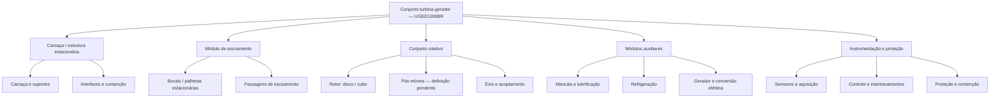
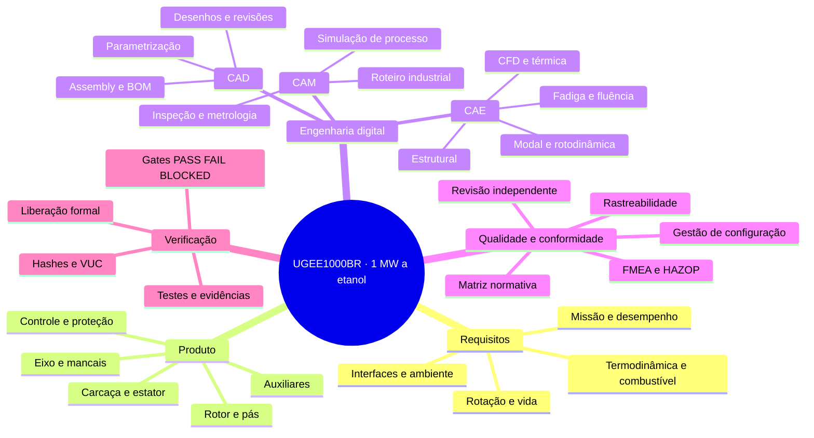

# Dossiê de Engenharia Industrial — UGEE1000BR

**Projeto:** Rotor de turbina a etanol — Aero Concepts — 1 MW (designação de projeto)  
**Repositório:** `scoobiii/parametrIX` · **PR:** #7  
**Documento:** `INDUSTRIAL_ENGINEERING_DOSSIER.md`  
**Revisão:** 0.1 · **Estado:** DOCUMENTO CONCEITUAL / REQUISITOS INCOMPLETOS  
**Data:** 2026-11-27  
**Responsabilidade:** ParametrIX — engenharia de sistemas e rastreabilidade; aprovação técnica pendente.

> **Limite de utilização:** este dossiê organiza arquitetura, dados de entrada, entregáveis e gates de verificação. Não é desenho de fabricação, especificação liberada, procedimento de montagem, programa CNC, validação física nem autorização para construir, operar ou testar uma turbina. Um rotor de alta rotação e potência exige equipe de engenharia habilitada, instalações industriais qualificadas, análise formal de perigos e validação independente.

## 1. Resumo executivo e estado da evidência

O PR #7 adiciona um pacote de protótipo para o projeto UGEE1000BR: especificação JSON, verificador de completude, registro de referências normativas, rota de harness, gate do kernel CAD/CAE/CAM e evidências de interface.

O estado correto do projeto permanece **`PROTOTYPE_REQUIREMENTS_INCOMPLETE`**. A especificação registra como ausentes, entre outros, rotação nominal e máxima, temperaturas, vazão mássica, razão de pressão, diâmetros, número e definição das pás, material, vida de projeto e fator de overspeed.

O artefato `ugee1000br.kernel-gate.json` registra um **PASS computacional de kernel/protótipo** baseado no perfil genérico `preset-aero-titanium`. Esse resultado não demonstra que a geometria seja o rotor definitivo UGEE1000BR, não equivale a CAE físico independente e não comprova integridade estrutural, dinâmica de rotores, desempenho termodinâmico ou aptidão para fabricação. O verificador de requisitos `ugee1000br.validation.json` corretamente mantém o estado BLOCKED.

## 2. Arquitetura funcional — componentes e subsistemas

A arquitetura abaixo é uma decomposição funcional preliminar (PBS — Product Breakdown Structure). A configuração final depende de definir primeiro o ciclo termodinâmico e a topologia da turbina (axial, radial ou outra). Não se deve presumir que todos os itens se apliquem à configuração final.

| WBS | Componente / subsistema | Função de sistema | Dados de engenharia requeridos | Evidência/inspeção prevista |
|---|---|---|---|---|
| 1.0 | Conjunto turbina-gerador | Converter energia do fluido em potência elétrica | ciclo, potência líquida/bruta, interfaces, regime operacional | balanço de energia e revisão de sistema |
| 1.1 | Rotor / disco / cubo | Elemento rotativo principal | topologia, envelope, cargas, rotação, material, vida | CAD controlado, análise estrutural e dinâmica |
| 1.2 | Pás / palhetas móveis | Transferência de energia entre fluido e rotor | número, perfil aerodinâmico, ângulos, cargas térmicas e centrífugas | definição aerotermodinâmica e inspeção dimensional |
| 1.3 | Eixo e acoplamento | Transmitir torque ao trem de potência | torque, rotação, alinhamento, interfaces e espectro de carga | análise de eixo, alinhamento e inspeção |
| 1.4 | Mancais / rolamentos | Suportar o conjunto rotativo | cargas, velocidade, lubrificação, temperatura, vida | análise do fabricante e plano de monitoramento |
| 1.5 | Carcaça / estator | Conter e posicionar componentes estacionários | pressão, temperatura, expansão, contenção e interfaces | CAD, análise térmica/estrutural e inspeção |
| 1.6 | Palhetas estacionárias / bocais | Condicionar o escoamento | ciclo, distribuição de pressão/temperatura e geometria de escoamento | análise fluidodinâmica e revisão especializada |
| 1.7 | Sistema de combustível | Condicionar e fornecer etanol | especificação do combustível, vazão, pressão, materiais compatíveis | análise de processo, compatibilidade e segurança |
| 1.8 | Lubrificação e refrigeração | Controlar temperatura e atrito | cargas térmicas, fluido, vazão, redundância e alarmes | análise térmica e validação de subsistema |
| 1.9 | Instrumentação e controle | Monitorar e comandar o sistema | sensores, faixas, precisão, intertravamentos e estados seguros | FMEA/HAZOP, testes de integração e rastreabilidade |
| 1.10 | Proteções e contenção | Mitigar falhas e riscos de operação | cenários de falha, energia armazenada, limites e requisitos legais | análise independente de riscos e validação física |
| 1.11 | Gerador e conversão elétrica | Converter potência mecânica em elétrica | potência, rotação, tensão, frequência, refrigeração e proteção | estudos elétricos e ensaios qualificados |
| 1.12 | Base, suportes e interfaces | Sustentar e alinhar os conjuntos | cargas, vibração, expansão, fundação e interfaces | análise estrutural e inspeção de montagem |

**Regra de configuração:** cada componente deverá ter identificador único, revisão, material controlado, unidade explícita, origem do requisito, responsável, método de verificação e vínculo com os artefatos CAD/CAE/CAM. Não atribuir dimensões ou materiais por analogia com o preset do kernel.

## 3. Registro mestre de entradas (Input Data Register)

Os campos abaixo devem ser fornecidos e aprovados pelo responsável técnico antes de se declarar a geometria nominal. O arquivo de referência atual é `projects/ugee1000br/ugee1000br.rotor.spec.json`.

| Grupo | Entrada requerida | Unidade / formato | Estado atual |
|---|---|---|---|
| Missão | potência nominal e envelope operacional | MW, horas, ciclos | 1 MW consta como designação; envelope pendente |
| Termodinâmica | ciclo, fluido de trabalho e propriedades | modelo e unidades SI | PENDENTE |
| Termodinâmica | temperaturas de entrada/saída | K | PENDENTE |
| Termodinâmica | pressão/razão de pressão | Pa / adimensional | PENDENTE |
| Termodinâmica | vazão mássica | kg/s | PENDENTE |
| Rotodinâmica | rotação nominal e máxima | rpm | PENDENTE |
| Rotodinâmica | transientes, partidas e paradas | perfil temporal | PENDENTE |
| Rotor | diâmetro externo e diâmetro do cubo | mm | PENDENTE |
| Rotor | topologia, número de pás e interfaces | definição controlada | PENDENTE |
| Materiais | liga, condição metalúrgica e rastreabilidade | especificação controlada | PENDENTE |
| Materiais | propriedades em função da temperatura | curvas/dados qualificados | PENDENTE |
| Vida | vida de projeto e espectro de ciclos | h / ciclos | PENDENTE |
| Integridade | critérios de fadiga, fluência e fratura | critérios aprovados | PENDENTE |
| Integridade | requisito de overspeed e base de validação | requisito aprovado | PENDENTE |
| Fabricação | capacidade, processo e cadeia de fornecimento | plano industrial | PENDENTE |
| Qualidade | tolerâncias, datums e plano metrológico | desenho/ plano de inspeção | PENDENTE |
| Conformidade | base normativa e autoridade aplicável | matriz aprovada | PENDENTE |

Não preencher lacunas com estimativas não aprovadas. A ausência de uma entrada crítica deve resultar em **BLOCKED**, nunca em PASS por valor default.

## 4. Fluxo de engenharia digital — CAD / CAE / CAM

### 4.1 CAD — definição e controle geométrico

**Objetivo:** manter uma definição geométrica rastreável, revisável e associada aos requisitos aprovados.

Entregáveis previstos:
- modelo paramétrico nativo e histórico de construção;
- assembly com referências, interfaces e datums;
- desenho 2D controlado, lista de materiais (BOM) e tabela de revisões;
- exportações neutras STEP e malha STL apenas para intercâmbio/visualização, com unidades e tolerâncias documentadas;
- relatório de validação geométrica, integridade topológica e comparação entre revisões.

**Gate CAD:** requisitos geométricos aprovados; unidades e datums consistentes; modelo sem erros topológicos conhecidos; revisão e hashes registrados. O gate do kernel atual demonstra apenas execução computacional de um preset genérico, não valida a geometria final do rotor.

### 4.2 CAE — verificação e validação de engenharia

A campanha CAE deve ser planejada por especialistas e usar modelos físicos, condições de contorno e dados de material rastreáveis. Matriz conceitual de disciplinas:

| Disciplina | Pergunta de engenharia | Entradas mínimas | Saída controlada |
|---|---|---|---|
| CFD / aerotermodinâmica | O escoamento atende ao ciclo e ao desempenho requeridos? | ciclo, propriedades, condições de contorno, geometria | relatório de convergência, balanços e incerteza |
| Estrutural | A estrutura atende aos casos de carga definidos? | geometria, material qualificado, cargas e restrições | tensões, deformações, margens e limitações |
| Térmica | Gradientes e transientes são aceitáveis? | temperaturas, transferência de calor e propriedades | campos térmicos e casos críticos |
| Fadiga / fluência | A vida requerida é suportada? | espectro de ciclos, temperatura e dados de material | avaliação de vida e incerteza |
| Modal / rotodinâmica | Modos e comportamento dinâmico são aceitáveis? | massa, rigidez, mancais, interfaces e regime | frequências, formas modais e revisão especializada |
| Tolerâncias | A cadeia dimensional atende à montagem? | datums, tolerâncias e interfaces | análise de stack-up e plano de medição |

**Gate CAE:** solver e versão identificados; modelo e malha revisados; convergência e sensibilidade documentadas; dados de entrada aprovados; revisão independente concluída. Resultados analíticos não substituem ensaios físicos qualificados.

### 4.3 CAM — planejamento industrial

**Objetivo:** planejar e verificar a industrialização sem converter o protótipo atual em instrução de fabricação.

Entregáveis de processo, em nível de planejamento:
- roteiro de fabricação por componente e revisão;
- matriz componente × processo × recurso industrial;
- plano de fixação e referências de processo, a ser elaborado e aprovado por manufatura;
- estratégia de inspeção em processo e final;
- identificação do pós-processador, máquina, ferramentas e versões, quando aplicável;
- simulação digital, revisão de colisões e validação independente antes de qualquer liberação;
- plano de rastreabilidade de matéria-prima, lote, operador, equipamento e inspeções.

**Gate CAM:** desenho e revisão liberados por engenharia; processo aprovado por manufatura e qualidade; recursos e pós-processador qualificados; simulação e inspeção aprovadas. O toolpath de 744 pontos reportado pelo kernel é uma evidência interna de protótipo, não um programa CNC liberado, nem prova de capacidade de máquina ou segurança de processo.

## 5. Vista explodida — arquitetura conceitual

A vista abaixo é uma **explosão funcional esquemática**, sem escala, sem geometria dimensional e sem sequência de montagem. Ela não define quantidade, orientação, fixação ou interfaces finais. Deve ser substituída por uma vista explodida derivada do assembly CAD aprovado quando a arquitetura estiver congelada.

**Critério para a vista explodida CAD:** cada item deve apontar para um Part Number, revisão, quantidade aprovada, material controlado, referência de interface e balloon da BOM. Não publicar dimensões, tolerâncias ou instruções de montagem até a revisão formal do conjunto.

## 6. Mind map — gestão integrada do projeto

## 7. Matriz de gates e critérios de saída

| Gate | Estado inicial | Critério para avançar |
|---|---|---|
| G0 — requisitos | BLOCKED | entradas críticas completas, unidades e responsáveis aprovados |
| G1 — arquitetura | BLOCKED | topologia e interfaces revisadas |
| G2 — CAD | PROTOTYPE ONLY | modelo controlado, BOM e desenho revisados |
| G3 — CAE | NOT VALIDATED | campanha por disciplina, revisão independente e evidências |
| G4 — CAM | NOT RELEASED | processo industrial qualificado e plano de inspeção aprovado |
| G5 — qualidade | NOT ASSESSED | rastreabilidade, inspeções e não conformidades tratadas |
| G6 — validação física | NOT EXECUTED | plano e ensaios em instalações qualificadas, com aprovação técnica |
| G7 — liberação | BLOCKED | todas as autoridades e responsáveis formais aprovam a configuração |

Estados permitidos por etapa: **PASS**, **FAIL** ou **BLOCKED**. PASS deve sempre declarar escopo, método, versão, entradas, evidência e limitações. Um PASS de software não pode ser promovido a PASS físico ou normativo.

## 8. Referências, qualidade e gestão de configuração

O arquivo `normative-registry.json` é apenas um índice de referências candidatas. A organização deve confirmar aplicabilidade, edição vigente, licença/acesso ao texto controlado, requisitos contratuais e autoridade competente. A simples presença de uma norma no registro não constitui conformidade.

Controles mínimos:
- identificador único e revisão para requisito, componente, desenho, análise e processo;
- aprovação e trilha de auditoria para mudanças;
- ligação bidirecional requisito → componente → análise → inspeção → evidência;
- gestão de não conformidades e concessões;
- segregação entre resultado de simulação, resultado de ensaio e decisão de liberação;
- assinatura técnica e responsabilidade formal nas decisões de segurança.

## 9. Integração com ParametrIX / VUC

Estrutura existente no PR:
- `projects/ugee1000br/ugee1000br.rotor.spec.json` — especificação preliminar;
- `projects/ugee1000br/ugee1000br.validation.json` — gate de completude;
- `projects/ugee1000br/ugee1000br.kernel-gate.json` — evidência do kernel;
- `projects/ugee1000br/normative-registry.json` — índice normativo;
- `projects/ugee1000br/harness-route.md` — rota do harness.

Para cada execução futura, registrar: commit, ambiente, versões de ferramentas, configuração, hashes SHA-256 dos inputs/outputs, logs, artefatos, duração, resultado do gate, limitações e identidade do aprovador. O VUC deve selar integridade e proveniência dos artefatos; não deve ser apresentado como prova autônoma de segurança física ou conformidade.

## 10. Pendências para revisão 0.2

1. Definir topologia da turbina e ciclo termodinâmico.
2. Obter e aprovar os dados de entrada da seção 3.
3. Definir arquitetura do rotor e interfaces com eixo, mancais, estator e carcaça.
4. Criar BOM preliminar com Part Numbers e status de cada item.
5. Elaborar modelo CAD nominal somente após fechamento dos requisitos.
6. Aprovar plano CAE por disciplina, solver, dados de material e revisão independente.
7. Aprovar plano industrial CAM e plano de qualidade/metrologia.
8. Definir base normativa, autoridade competente e responsáveis.
9. Atualizar gates e evidências sem promover resultados de protótipo a validação física.

---

**Conclusão:** o PR #7 passa a ter um dossiê industrial conceitual para organizar arquitetura de componentes, entradas, processo CAD/CAE/CAM, vista explodida funcional e mapa mental. O projeto continua **BLOCKED para definição final, fabricação e operação** até que os requisitos e as validações formais sejam concluídos.
